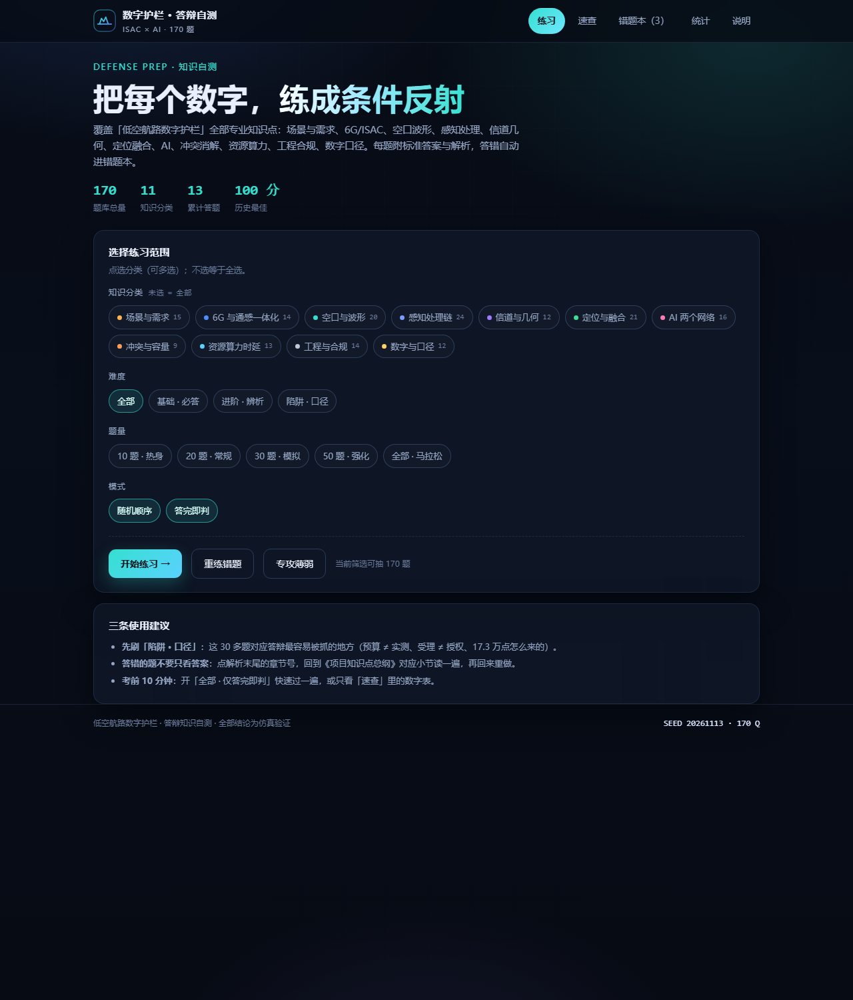

# 数字护栏 · 答辩知识自测（单文件题库网站）

> **在线访问**：<https://xz18078151342-ops.github.io/6g3/>
> **代码仓库**：Gitee `gan-di-xuan/6g3` · GitHub `xz18078151342-ops/6g3`
> 说明：Gitee Pages 服务已于 2024 年停止，公开访问页由 GitHub Pages 托管；Gitee 侧保留完整源码与提交记录。
>
> 用途：答辩前自测「低空航路数字护栏」项目的专业知识点。**170 道选择题**，11 个分类，每题带标准答案、解析与《项目知识点总纲》章节索引。
> 形态：**一个 `index.html`，零依赖、离线可用**，双击即开。



---

## 一、怎么打开

| 方式 | 做法 |
|---|---|
| 本机（推荐） | 双击 `index.html`，用 Edge / Chrome 打开 |
| 手机 / 同局域网 | 在 `答辩题库` 目录执行 `python -m http.server 8080`，手机访问 `http://电脑IP:8080` |
| 公网 | 把整个目录（或只把 `index.html`）传到任意静态托管（GitHub Pages、OSS、Netlify） |

> 无需联网、无需安装、无后端。所有题目与样式都内联在 `index.html` 里，单独拷走这一个文件也能用（预览图会丢，功能不受影响）。

## 二、题库结构

| 分类 | 题量 | 内容 |
|---|---|---|
| 场景与需求 | 15 | 低空经济、真高 120 m、四类痛点、现有手段边界、8 项 KPI、五阶段 |
| 6G 与通感一体化 | 14 | IMT-2030、网络侧感知、四份标准、跨站相参、自干扰、波束、同步 |
| 空口与波形 | 20 | OFDM 参数、栅格/分辨率、无模糊、相参积累、参考除法、窗函数 |
| 感知处理链 | 24 | MTI/MTD、盲区、CFAR、Swerling、雷达方程、CRLB、插值、算力账 |
| 信道与几何 | 12 | UMa-AV、LOS/NLOS、slab 法、RCS、杂波、GNSS 误差模型 |
| 定位与融合 | 21 | EKF、Joseph、卡方门限、GDOP、异方差加权、CEP95、A/B/C 消融 |
| AI 两个网络 | 16 | MLP/Adam/BCE、9 维特征、双头、自举、域偏移、TrajNet |
| 冲突与容量 | 9 | 双门限、提前量、误报率、分级处置、容量换算 |
| 资源算力时延 | 13 | 香农与 ρ、三层算力、TOPS/GFLOPS、CPI 硬底、27.3 ms 预算 |
| 工程与合规 | 14 | TRL、受理与授权、可复现、匿名、视频规格、SEP/FRAND |
| 数字与口径 | 12 | 17.3 万点、29.2 dB、混淆矩阵、40% 重叠、K7 未达标 |

其中 **6 道多选**（需选全才得分），难度分「基础 / 进阶 / 陷阱」三档，可直接筛「陷阱 · 口径」专攻答辩最容易被抓的点。

## 三、功能

- **组卷**：按分类多选 + 难度 + 题量（10/20/30/50/全部）+ 随机顺序。
- **两种判分**：`答完即判`（每题立刻看解析）或关闭后统一结算。
- **错题本**：答错自动收录，可重练、单题移除、清空；`专攻薄弱` 优先抽历史正确率低的分类。
- **统计**：练习次数、累计题量、总正确率、最佳单轮、分类正确率、最近 12 次记录。
- **速查**：核心数字表、六个必背公式、20 组易混概念、6 条口径自查——考前 10 分钟只看这一页。
- **键盘**：`1–4` 选项、`Enter` 提交/下一题、`Esc` 退出；中途切标签会二次确认。
- **移动端**：390 px 宽度已实测，选项、顶栏、表格均自适应。

## 四、数据存在哪

- 错题、统计、设置存在浏览器 `localStorage`，键名 `6g-quiz-v1`。
- **不上传任何数据、不发网络请求**；换浏览器/清缓存会丢记录。
- 想清空：页面「统计 → 清空统计」清记录（保留错题），「错题本 → 清空错题」清错题；或在开发者工具里删除该键。

## 五、怎么改题 / 加题

题目集中在 `index.html` 的 `<script>` 顶部：

```js
Q(分类, 难度, "题干", "选项A|选项B|选项C|选项D", 正确答案, "解析", "章节号")
```

- 分类：`scene / isac / wave / sense / chan / pos / ai / conf / res / eng / num`
- 难度：`1` 基础、`2` 进阶、`3` 陷阱
- 选项之间只能用 `|` 分隔；**选项里不要再出现 `|` 或英文双引号**（中文引号可以）
- 单选答案写数字（从 0 开始）；多选写成 `"0,2"` 这样的字符串
- 章节号对应 `项目知识点总纲.md` 的小节，如 `"4.2"`；写 `"附录A"` 也可以

加载时会对每题选项做**固定种子的乱序**（同一题每次打开顺序一致），避免“答案总在 A”。加题后，首页与页脚的题量会自动更新。

## 六、内容口径

- 题目由项目材料反向命题：`02_作品方案_场景设计.docx`、`06_代码/sim/*.py`、`results/results.json`、`08_5分钟路演稿与答辩手册.md`、`00_提交清单与操作指南.md`。
- 解析末尾的章节号指向 `项目知识点总纲.md`，可对照阅读。
- 所有数字均为**仿真验证**口径；题库刻意设置了“预算 ≠ 实测”“受理 ≠ 授权”“仿真 ≠ 实测”一类陷阱题。

## 七、已验证

在 Edge 无头浏览器（1280×1500 与 390×880 两种视口）实测通过：

- 170 题、11 分类全部渲染；分类筛选、难度筛选、题量、随机顺序正常；
- 单选/多选判分正确（多选部分选中判错）、答错入错题本、错题本与统计持久化；
- 关闭「答完即判」后不泄露答案、自动进入下一题、结算正确；
- 中途切换标签有确认、取消后留在原题；
- 键盘 `1–4` / `Enter` 生效；
- 无运行时报错（`Runtime.exceptionThrown` 为空）。

> 题库用于赛前自测，不替代对代码与方案原文的阅读；答辩时“仿真 / 预算 / 折算 / 受理”这些限定词一个都不能省。
